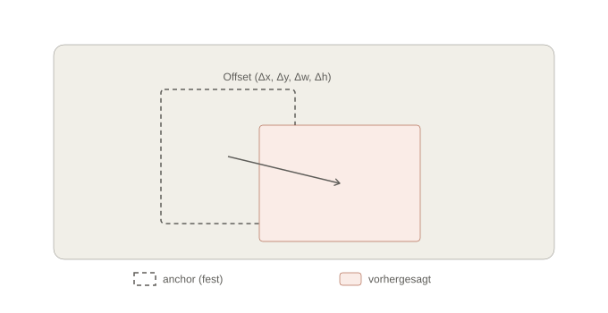
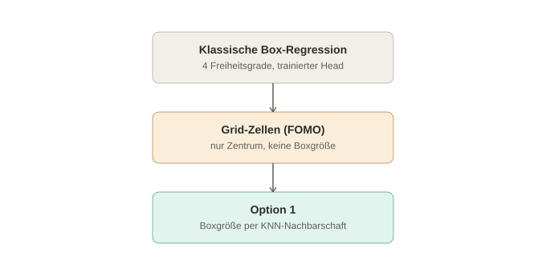
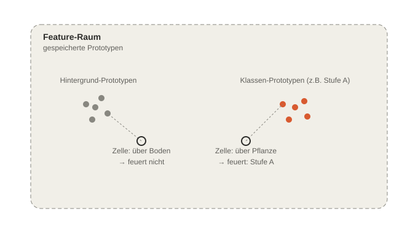
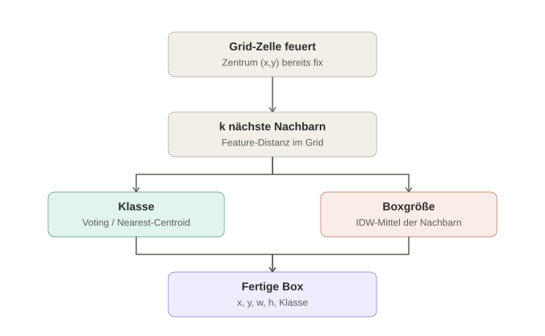
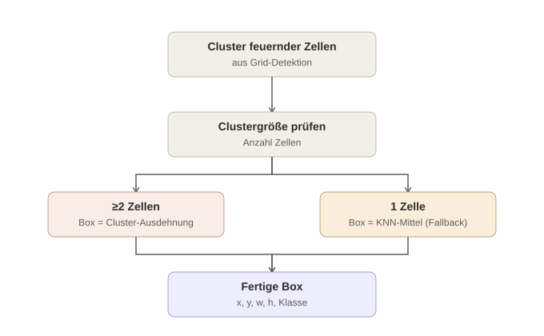

# Option 1 — Prototyp-basierte (KNN-)Regression für Box-Geometrie

**Zielszenario:** Wachstumsstufen-Erkennung bei Mais per Drohne, ausgehend von der bestehenden On-Device-Architektur (MobileNetV2 → optional PCA → `LightweightKNN`/`NearestCentroidClassifier` in [client/tinylcm_python/knn.py](../client/tinylcm_python/knn.py)).

## 1. Konzept im Überblick

**Kurzfassung:** Statt Bounding-Box-Größe über einen separat trainierten Regressions-Head zu lernen, wird sie wie das Klassenlabel als Metadatum an jedes Referenz-Sample gehängt und beim Vorhersagen aus den k nächsten Nachbarn im Feature-Raum abgeleitet — mit derselben Distanzlogik, die heute schon für die Klassenabstimmung existiert. Kein neuer Trainingsalgorithmus, kein Backprop, nur `add_sample()`.

Die drei bisher diskutierten Ansätze zur Box-Geometrie bauen aufeinander auf, sie sind keine unabhängigen Alternativen — jede Stufe reduziert, was tatsächlich noch "gelernt" werden muss:

1. **Klassische Box-Regression** (Faster R-CNN/SSD/YOLO): 4 Freiheitsgrade (`Δx, Δy, Δw, Δh`), gelernt per Gradientenabstieg in einem eigenen trainierten Head, getrennt vom Klassifikations-Head.

   

2. **Grid-Zellen/FOMO**: `Δx, Δy` entfallen komplett, weil das Zentrum automatisch aus der Position der feuernden Grid-Zelle folgt (siehe Abschnitt 3). Im FOMO-Original endet es hier — es gibt nur einen Punkt, keine Boxgröße.

   

3. **Option 1 (dieses Dokument)**: schließt genau die von FOMO offen gelassene Lücke (Boxgröße `w, h`), aber nicht-parametrisch über KNN-Nachbarschafts-Mittelung statt über einen trainierten Head — bleibt damit konsistent zur bestehenden on-device-Lernphilosophie.



**Kernunterschied zu CenterNet/FCOS** (siehe Related Work, Abschnitt 5): Diese Arbeiten nutzen exakt dasselbe Prinzip "Zentrum kommt aus Peak/Zelle, Größe wird separat bestimmt", regressieren die Größe aber weiterhin über einen klassisch trainierten (Gradienten-)Head. Option 1 ersetzt diesen Head durch eine nicht-parametrische KNN-Mittelung — das ist die eigentliche Neuheit/Lücke, die in der Literatur nicht direkt besetzt ist.

**Warum Option 1 statt Option 2 als Startpunkt:** Keine neue Architekturkomponente nötig, passt zum Grid-Zellen-Ansatz. Option 2 (RLS-basierter linearer Regressions-Head) bleibt Ausweichoption, falls die Nachbarschafts-Mittelung zu ungenau ist oder ihr stattdessen die zweistufige Detect-then-Classify-Variante mit variablem Boxzentrum verfolgt.

## 2. Warum die Boxgröße beim on-device Training mitgelernt werden muss

Bei reiner Bildklassifikation reicht es, wenn sich nur das Aussehen der Klassen mit der Zeit anpasst. Bei Wachstumsstufen ist das nicht ausreichend:

- **Die Wachstumsstufe ist selbst über die Größe definiert.** Eine falsch bemessene Box bei sonst korrekter Klassifikation ("richtig erkannt: Stufe 3, aber Box zu klein") liefert bei allem, was danach mit der Box passiert — Flächenschätzung, Bestandsdichte, potenziell spätere Biomasse-Ableitung aus der Boxfläche — ein falsches Ergebnis, obwohl die Klassifikation stimmt.
- **Geometrie unterliegt demselben Drift-Problem wie die Klassifikation**, wird aber leicht übersehen. Flughöhe, Kamerawinkel, Sorte oder Lichtverhältnisse ändern sich von Feld zu Feld und Saison zu Saison; die tatsächliche Pixelgröße einer "Stufe-2"-Pflanze verschiebt sich dadurch genauso wie ihr Erscheinungsbild driften kann. Wenn nur die Klassifikation adaptiv ist, die Boxgröße aber aus einem einmal server-seitig trainierten Head stammt, bekommt ihr zwar weiterhin die richtige Klasse, aber eine zunehmend falsch bemessene Box — ein blinder Fleck, den das On-Device-Learning-Konzept eigentlich gerade vermeiden soll.
- Option 1 sorgt dafür, dass **ein einziger `add_sample()`-Aufruf beides gleichzeitig nachführt**, Klasse und Geometrie, statt die Geometrie stillschweigend statisch zu lassen.

## 3. Baustein: Wie eine Grid-Zelle "feuert"

"Feuern" heißt: Für eine einzelne Grid-Zelle fällt die Entscheidung "hier ist ein Objekt" statt "hier ist nur Hintergrund" — über denselben Prototyp-Vergleich wie die Klassenzuordnung selbst, nicht über einen separaten Mechanismus. Das ist die Voraussetzung dafür, dass in Option 1 das Boxzentrum bereits feststeht, bevor die Boxgröße bestimmt wird.



Zwei Umsetzungsvarianten:

- **A) Explizite Hintergrund-Klasse (einfachste Umsetzung, kein neuer Code):** Beim Sammeln von Referenzsamples werden nicht nur Pflanzen-Crops, sondern auch Zellen über Boden/leerem Feld/Blattwerk explizit als eigene Klasse (z.B. `"hintergrund"`) per `add_sample()` eingefügt — wie jede andere Klasse auch. Die Zelle "feuert", wenn `predict()` eine echte Wachstumsstufen-Klasse liefert, und "feuert nicht", wenn `"hintergrund"` gewinnt. Reine Datenerweiterung, keine Architekturänderung.
- **B) Distanz-Schwellenwert (zusätzliche Robustheit, erfordert Code-Erweiterung):** Zusätzlich oder statt A kann ein Schwellenwert `τ` auf die Distanz zum nächsten Prototyp gesetzt werden — liegt der nächste Nachbar weiter als `τ` entfernt, gilt die Zelle unabhängig vom Voting-Ergebnis als "kein Treffer". Erfordert eine Erweiterung von `predict()`/`_find_neighbors()`, die es aktuell nicht gibt (heute liefert `predict()` immer eine Klasse, sobald Trainingsdaten vorhanden sind, ohne Distanz-Cutoff).

Empfehlung: mit A starten (kein Codeaufwand), B als Verfeinerung ergänzen, falls sich die Hintergrund-Klasse allein als zu unspezifisch erweist — Hintergrund ist visuell extrem vielfältig (Boden, Beleuchtung, andere Pflanzenteile), schwer mit wenigen Prototypen abzudecken.

## 4. Kernmechanismus von Option 1

Ablauf für eine einzelne feuernde Grid-Zelle:

1. **Grid-Zelle feuert** — Zentrum `(x, y)` steht damit bereits fest (siehe Abschnitt 3).
2. **k nächste Nachbarn** im Feature-Raum werden bestimmt (gleiche Distanzlogik wie heute, `_find_neighbors()`).
3. Diese k Nachbarn werden **parallel zweimal ausgewertet**, ohne zweiten Modellteil:
   - **Klasse**: Voting bzw. Nearest-Centroid — unverändert wie im bestehenden `LightweightKNN`/`NearestCentroidClassifier`.
   - **Boxgröße**: IDW-gewichteter Mittelwert der bei den Nachbarn gespeicherten `w, h` — neue Methode `predict_bbox()`, die dieselben Nachbarn und Gewichte wiederverwendet.
4. Beide Ergebnisse werden zur **fertigen Box** `(x, y, w, h, Klasse)` zusammengeführt.

Der Kernpunkt: Klasse und Geometrie werden aus **denselben** k Nachbarn abgeleitet, es gibt keinen separaten, eigens trainierten Geometrie-Kopf.



**Implementierungsdetails:**

- `add_sample()`/`incremental_fit()` bekommt zusätzlich eine Boxgröße (`w, h`, normiert auf Grid-Zellgröße).
- Für `NearestCentroidClassifier`: laufender Mittelwert der Boxgröße pro Klasse (Welford-Update), O(1) pro neuem Sample.
- Retraining läuft über denselben `add_sample`-Aufruf wie heute — kein neuer Trainingsalgorithmus, keine Gradienten.
- Wichtige Vereinfachung durch den Grid-Zellen/FOMO-Ansatz: nur 2 Freiheitsgrade (w, h) statt volle 4-DOF-Regression (Δx, Δy, Δw, Δh) nötig, macht den Nachbarschafts-Durchschnitt deutlich robuster.
- State-Format-Erweiterung: paralleles Array `box_dims` neben `X_train`/`y_train` in `get_state()`/`set_state()`.

## 5. Related Work (Recherche)

**Direkte Vorläufer für "Zentrum aus Zelle/Peak, Größe separat bestimmt":**

- **"Objects as Points" (CenterNet)** — Zhou, Wang, Krähenbühl, 2019, arXiv:[1904.07850](https://arxiv.org/abs/1904.07850). Modelliert Objekte als einzelnen Punkt (Zentrum), andere Eigenschaften (Größe, 3D-Extent, Orientierung) werden direkt aus den Bildmerkmalen an der Zentrumsposition regressiert — per Heatmap-Peak statt Anchor. Die Größe wird aber weiterhin über einen trainierten Regressions-Head (L1-Loss) gelernt, nicht nicht-parametrisch. Genau das architekturelle Vorbild für "Zentrum kommt gratis, Größe separat", nur mit klassischem statt KNN-basiertem Größenkopf.
- **"FCOS: Fully Convolutional One-Stage Object Detection"** — Tian et al., 2019, arXiv:[1904.01355](https://arxiv.org/abs/1904.01355). Pro-Pixel-Prädiktion von Klasse und Box-Regression ohne vordefinierte Anchors — ein weiteres Beispiel für den "jede Grid-/Pixel-Position sagt ihre eigene Box vorher"-Ansatz, ebenfalls mit trainiertem Regressionskopf statt Nachbarschafts-Mittelung.
- **FOMO (Faster Objects, More Objects)** — Edge Impulse, 2022, [Blogpost](https://www.edgeimpulse.com/blog/announcing-fomo-faster-objects-more-objects/) (kein DOI, Industrie-Whitepaper). Bestätigt explizit die Beobachtung aus der Diskussion: "FOMO does not output bounding boxes... the size of the object is not available" — die hier zu schließende Lücke ist also auch dem Originalautoren-Team bekannt und bewusst nicht gelöst.

**Präzedenzfall für klassenspezifische Größen-Priors:**

- **YOLO9000 / YOLOv2 — "Better, Faster, Stronger"** — Redmon & Farhadi, CVPR 2017. Nutzt k-means-Clustering (mit 1−IoU als Distanzmetrik) auf den Ground-Truth-Boxgrößen des Trainingsdatensatzes, um gute Anchor-Prioren statt handgewählter Werte zu bestimmen. Konzeptionell verwandt mit der Idee "durchschnittliche Boxgröße pro Klasse/Cluster speichern" — Redmon & Farhadi clustern aber offline vor dem Training, nicht online/inkrementell wie bei Option 1.

**Bewertung der Recherchelücke:** Es wurde keine Arbeit gefunden, die Bounding-Box-Größe speziell über **k-nearest-neighbor-Regression** (nicht-parametrisch, inkrementell aktualisierbar, ohne Trainingsschritt) bestimmt — die üblichen Ansätze (CenterNet, FCOS, YOLO-Anchor-Clustering) verwenden entweder einen trainierten Regressions-Head oder eine einmalige Offline-Clusterung. Die Kombination aus (a) Grid-Zellen-Lokalisierung, (b) klassenbasiertem/nachbarschaftsbasiertem Prototyp-Matching für die Klasse und (c) KNN-Mittelung für die Boxgröße, alles im selben inkrementellen On-Device-Update-Schritt, scheint in der gesichteten Literatur keine direkte Entsprechung zu haben — d.h. Option 1 wäre eine echte (kleine) Neukombination bestehender Bausteine, kein reines Reimplementieren publizierter Arbeit.

## 6. Fazit: Schwächen des Ansatzes

- **Fragliche Kausalitätsannahme:** Die Methode überträgt implizit "ähnliches Aussehen (Feature-Nähe) → ähnliche Größe" auf die Geometrie. Das stimmt nicht immer — zwei Zellen derselben Klasse können durch unterschiedlichen Kameraabstand oder Teilverdeckung sehr verschiedene tatsächliche Pixelgrößen haben, ohne dass das im Feature-Vektor sichtbar wird. → Ausführlich behandelt inkl. Lösungsansätzen in Abschnitt 7.
- **Cold-Start-Problem:** Bei wenigen Samples pro Klasse (gerade am Anfang des on-device Lernens) ist der Nachbarschafts-Mittelwert stark verrauscht; ein einzelner Ausreißer kann die geschätzte Boxgröße spürbar verzerren, da nur IDW-Mittelung, kein robusterer Schätzer (z.B. Median) vorgesehen ist.
  - *Relativierung:* Mit einem kuratierten Startset aus den Trainingsdaten (statt bei null zu beginnen) ist das Problem für die bereits abgedeckte Verteilung von Tag 1 an weitgehend entschärft — die IDW-Mittelung stützt sich von Anfang an auf viele Nachbarn. Es verschwindet aber nicht grundsätzlich, sondern verschiebt sich: Es tritt wieder auf, sobald on-device neue, im Startset nicht repräsentierte Bedingungen (neues Feld, neue Sorte, Randfall) hinzukommen — dort ist die lokale Nachbarschaft anfangs wieder dünn besetzt, unabhängig von der Größe des Gesamtsets, da IDW nach Distanz der tatsächlich vorhandenen k Nachbarn gewichtet, nicht nach globaler Datendichte.
- **Keine echte Extrapolation:** Nicht-parametrische Verfahren interpolieren nur innerhalb bereits gesehener Boxgrößen. Taucht ein Feld mit deutlich größeren/kleineren Pflanzen auf als je gespeichert, bleibt die Vorhersage in Richtung der bekannten Nachbarn verzerrt — ein trainierter Regressions-Head könnte hier potenziell besser extrapolieren.
  - *Relativierung:* Wie stark das in der Praxis wiegt, hängt davon ab, wie viel Varianz (v.a. Flughöhe/Kamerawinkel) die Trainingsdaten bereits abdecken. Bei weitgehend konstanter Flugkonfiguration kommt Größenvarianz im Startset vermutlich fast nur aus der Wachstumsstufe selbst — dann ist der relevante Bereich vermutlich gut abgedeckt und die Schwäche in der Praxis gering. Der Drohnentyp wurde eingangs aber explizit als "erstmal außer Acht lassen, wird später relevant" eingeordnet — sobald sich Flughöhe/Kamera/Drohne später ändert, verschiebt sich die effektive Pixelgröße pro Wachstumsstufe potenziell außerhalb dessen, was im Startset je aufgenommen wurde. Genau in diesem Moment würde die Extrapolationsschwäche wieder praktisch relevant, unabhängig von der Größe des Startsets.
- **Positionsgenauigkeit bleibt grid-limitiert:** Auch wenn die Größe jetzt gelernt wird, bleibt das Zentrum an die Zellauflösung gebunden — bei grobem Grid ungenauer als eine echte `Δx, Δy`-Regression.
- **Mehr statt weniger Tuning:** `k` für die Klassifikation und `k` für die Boxgröße sind potenziell unterschiedlich optimal — zusätzlicher Hyperparameter, kein automatischer Gewinn.
- **Keine publizierte Vergleichsbaseline:** Wie die Related-Work-Recherche zeigt, gibt es keine direkte Vorarbeit zu KNN-basierter Boxgrößen-Regression — es ist offen, ob die erreichbare Genauigkeit für den Praxiseinsatz ausreicht, ohne Literatur-Referenzwerte zum Abgleich.
- **Enge Kopplung an den Grid-Zellen-Ansatz:** Option 1 setzt voraus, dass das Zentrum bereits feststeht. Sie funktioniert nicht eigenständig für die zweistufige Detect-then-Classify-Alternative, wo Boxen schon vollständig aus Stufe 1 kommen.

## 7. Vertiefung: Lösungsansätze für die Kausalitätsannahme

### 7.1 Vier Lösungsideen

1. **Direkte geometrische Messung aus der Cluster-Ausdehnung** (kein zweiter ML-Algorithmus, sondern Wiederverwendung des Detektionssignals): Feuern mehrere benachbarte Grid-Zellen für dasselbe Objekt, ergibt sich die Boxgröße direkt aus der räumlichen Ausdehnung dieses Zell-Clusters — eine Ist-Messung am aktuellen Bild statt eine Schätzung aus historischen Nachbarn. Löst die Kausalitätsannahme vollständig auf, dort wo ≥2 Zellen feuern. Schwäche: bei nur einer feuernden Zelle (vermutlich der Regelfall bei kleinen/frühen Wachstumsstufen) nicht anwendbar; Verdeckung bleibt ein Problem.
2. **Klassische Segmentierung als zweiter, unabhängiger Algorithmus**: ein Vegetations-/Farbindex trennt Pflanze von Boden, Bounding Box der zusammenhängenden Region wird direkt gemessen. Pragmatisch stark für Mais-auf-Boden (guter Farbkontrast), bricht aber mit der "alles ist on-device lernfähig"-Philosophie (Schwellenwert muss manuell nachjustiert werden, kein Lernmechanismus) und funktioniert schlecht bei Unkraut/gemischter Vegetation.
3. **Zweiter, unabhängiger Feature-/Distanzraum speziell für Größe**: eigens konstruierte, größenkorrelierte Merkmale mit eigenem KNN-Lookup nur für die Boxgröße, getrennt vom klassifikationsoptimierten Feature-Vektor. Theoretisch sauberste Lösung, praktisch am unsichersten — "welche Merkmale korrelieren mit Größe, aber nicht mit Erscheinungsbild" ist selbst ungelöst, zusätzlich verdoppelter Rechen-/Speicheraufwand auf dem Pi Zero 2W.
4. **Kontextuelle Normalisierung über bekannte Flughöhe/GSD**: siehe Abschnitt 7.3 — wurde zur strukturellen Lösung ausgebaut.

**Empfehlung (Stand dieser Diskussion):** Hybrid aus Idee 1 (primär, bei ≥2 feuernden Zellen) mit Option 1s KNN-Mittelung als Fallback (bei nur 1 feuernden Zelle). Größte offene Frage dabei: ob der Einzelzell-Fall in der Praxis die Ausnahme oder der Regelfall ist — hängt von der noch offenen Grid-Auflösung relativ zur tatsächlichen Pflanzengröße ab (siehe "Offene Punkte").



### 7.2 Kritischer Einwand: Widerspruch zum on-device-Lernprinzip

Der Hybrid-Ansatz (insbesondere Idee 1) unterläuft teilweise die ursprüngliche Prämisse von Option 1 — "ein `add_sample()`-Aufruf verbessert Klasse *und* Geometrie gemeinsam, kumulativ über die Zeit". Bei der Cluster-Ausdehnung wird die Boxgröße pro Bild frisch gemessen, nicht aus gespeicherten Erfahrungen gelernt: Ein vom Nutzer korrigiertes Sample verbessert dann zwar weiterhin die Klassifikation, aber **nicht** die zukünftige Boxgrößen-Schätzung für den Cluster-Pfad. Zusätzlich entstehen zwei grundverschiedene Geometrie-Mechanismen (gelernt vs. gemessen) im selben System, abhängig von einer für den Nutzer unsichtbaren internen Bedingung — das widerspricht dem einfachen mentalen Modell "ich füge ein Sample hinzu, das System wird überall besser".

**Positiv zu werten:** Die Drift-Robustheit ist bei der Messung sogar besser als beim Lernen — eine frische Messung pro Bild kann per Definition nicht veralten, während eine gelernte Schätzung aus alten Samples genau dem Drift-Problem unterliegt. Tausch: "lernfähig, aber driftanfällig" gegen "driftrobust, aber nicht lernfähig".

**Möglicher Ausweg — gelernter Korrekturfaktor:** Cluster-Ausdehnung als Rohmessung verwenden, aber einen klassenspezifischen Korrekturfaktor (`wahre_Boxgröße / gemessene_Ausdehnung`, laufender Mittelwert wie bei `box_dims`) per `add_sample()` mit korrigierten Nutzer-Boxen lernen. Restauriert das "beide gleichzeitig nachführen"-Prinzip, mit deutlich kleinerem Fehlerbudget als eine vollständige Größenschätzung aus dem Nichts.

**Verbleibende Schwäche des Korrekturfaktors:** Verschiebt das Problem, statt es zu lösen — (1) Cold-Start bleibt (Faktor startet bei 1.0, unkorrigiert), (2) korrigiert nur systematische, klassenweite Verzerrung, nicht Varianz pro Instanz (Verdeckung ist meist zufällig pro Pflanze, kein konstanter Klassen-Bias — die Fälle, die am meisten Korrektur bräuchten, profitieren am wenigsten), (3) die Staleness-Frage kommt zurück, nur schwächer: ein über die gesamte Historie gemittelter Korrekturfaktor kann selbst veralten, wenn sich Bedingungen ändern (neue Flughöhe → neue systematische Verzerrung).

### 7.3 Strukturelle Lösung für den Höhenfaktor: GSD-Normalisierung

Flughöhe wurde als der kritischste Einzelfaktor identifiziert — dafür gibt es eine strukturelle statt einer statistischen Lösung: Flughöhe ist keine unbeobachtete Störgröße, sondern eine **bekannte, messbare Variable** (Barometer-/GPS-Höhe aus der Drohnen-Telemetrie). Statt ihren Effekt nachträglich zu lernen/korrigieren, sollte sie **physikalisch herausgerechnet** werden, bevor überhaupt etwas gespeichert oder verglichen wird.

**Mechanismus — Ground Sample Distance (GSD):**

```
GSD [cm/px] = (Sensorbreite × Flughöhe) / (Brennweite × Bildbreite in px)
```

Jede Pixelmessung wird damit in eine höhenunabhängige Realgröße (cm) umgerechnet — deterministisch berechnet, nicht statistisch geschätzt. Rückumrechnung in Pixel für die Anzeige erfolgt am Ende mit der zur Inferenzzeit aktuellen Flughöhe.


**Voraussetzung — Höhendaten müssen in den Daten vorhanden sein:** Die Normalisierung funktioniert nur, wenn für jedes Bild, das in die Box-Größen-Referenz einfließt (Trainingsdaten *und* künftige on-device gesammelte Samples), eine der folgenden Angaben existiert: die Flughöhe zum Aufnahmezeitpunkt, eine bereits fertig berechnete GSD, oder ersatzweise eine bekannte, konstante Flughöhe (falls das gesamte Trainingsdatenset unter einem einheitlichen Flugprotokoll aufgenommen wurde — dann genügt eine einzige globale Umrechnungskonstante). Zwei Fälle sind zu prüfen:

1. **Trainingsdaten haben diese Info nicht und sie ist nicht rekonstruierbar** → GSD-Normalisierung ist für den bestehenden Datensatz nicht anwendbar, nur für künftig neu gesammelte on-device-Samples. Das erzeugt eine Inkonsistenz: das Startset bliebe im alten, höhenabhängigen Pixel-Maßstab, neue Samples kämen im normierten cm-Maßstab — beide wären dann nicht direkt vergleichbar, bis genug neue Daten den alten Bestand verdrängt haben.
2. **Trainingsdaten wurden unter konstanter/bekannter Flughöhe aufgenommen** → einfachster Fall, eine globale Umrechnungskonstante genügt rückwirkend für den gesamten Datensatz.

Zusätzlich, nicht nur rückwirkend: Für den Weiterbetrieb muss die Erfassungs-Pipeline selbst (Client-Code auf der Drohne/dem Pi) künftig bei jeder neuen Aufnahme die aktuelle Flughöhe mitschreiben, sonst funktioniert die Normalisierung ab jetzt genauso wenig wie rückwirkend.

**Wo das eingreift:**

- `box_dims` in `add_sample()`/`incremental_fit()`: cm-`w,h` statt Pixel-`w,h` speichern, umgerechnet mit der zur Aufnahmezeit gültigen Flughöhe.
- Cluster-Ausdehnung (Idee 1): gemessene Pixel-Ausdehnung sofort in cm umrechnen, bevor sie als Ergebnis oder neues Trainingssample verwendet wird.
- KNN-Nachbarschaftsvergleich: findet dann in einem einheitlichen, höhenunabhängigen Größenraum statt, statt implizit unterschiedliche Höhen zu vermischen.
- Ausgabe: am Ende mit aktueller Flughöhe zurück in Pixel für die Box-Anzeige im Originalbild.

**Was strukturell trotzdem übrig bleibt:**

- **Sensorgenauigkeit der Höhenmessung:** Barometrische Höhe ±1–2 m Fehler (unzuverlässig nahe am Boden durch Bodeneffekt), GPS-Höhe ohne RTK oft ±5–10 m — pflanzt sich direkt in die GSD-Umrechnung fort.
- **Geländehöhe/Bestandshöhe ≠ Flughöhe über Grund:** GPS/Barometer liefern Höhe über Meeresspiegel/Startpunkt, nicht die tatsächliche Distanz Kamera–Pflanzenkrone. Bei unebenem Gelände oder mit Bestandshöhe bräuchte es zusätzlich ein Geländemodell oder einen Abstandssensor (Lidar/Radar), also Zusatzhardware.
- **Kamerakalibrierung pro Drohnentyp:** Sensorbreite/Brennweite müssen als kalibrierte Konstanten bekannt sein — wird genau in dem Moment zum Thema, der eingangs schon als "später relevant" markiert wurde (Drohnenwechsel = neue Kamerakalibrierung).
- **Verdeckung bleibt komplett unberührt:** Diese Lösung behebt ausschließlich das Skalen-/Höhenproblem, nicht die strukturell andere Fehlerquelle Verdeckung.

Unterschied zum gelernten Korrekturfaktor: Hier wird die Ursache (Höhe) durch eine bekannte physikalische Beziehung exakt beseitigt, statt ihre Auswirkung nachträglich statistisch zu schätzen — eine strukturelle Lösung, kein weiteres Pflaster.

## 8. Offene Punkte für die Fortsetzung

- **Höhendaten-Verfügbarkeit prüfen** (neu, höchste Priorität vor jeder Implementierung): Enthalten die vorliegenden Trainingsdaten Flughöhe/GSD pro Bild, oder wurde mit konstanter Flughöhe geflogen? Entscheidet, ob Abschnitt 7.3 sofort umsetzbar ist oder zunächst nur für neu gesammelte Daten gilt.
- **Zellgröße/Grid-Auflösung festlegen**: bestimmt sowohl die Positionsgenauigkeit des Zentrums als auch die Granularität, mit der `w, h` normiert werden — und ob der Einzelzell-Fall (Abschnitt 7.1) die Ausnahme oder der Regelfall ist.
- **Wahl von k und Distanzmetrik für `predict_bbox()`**: evtl. eigenes `k_bbox` getrennt von `k` der Klassifikation, da beide unterschiedlich empfindlich auf Rauschen reagieren können.
- **Umgang mit Ausreißern in der Boxgröße** (z.B. teilverdeckte Pflanzen am Bildrand) — ggf. robusterer Schätzer (Median statt IDW-Mittelwert) nötig.
- **Empirischer Vergleich** Option 1 (KNN-Mittelung) vs. Option 2 (RLS-Head) vs. Cluster-Ausdehnung (Abschnitt 7.1) vs. klassenweiser Fixwert — noch nicht durchgeführt.
- **Wie viele Objekte/Boxgrößen-Varianz pro Bild** in den vorliegenden Forschungsdaten tatsächlich vorkommen, ist noch offen — beeinflusst, ob eine einfache Klassen-Durchschnitts-Baseline überhaupt ausreicht oder die Nachbarschafts-Mittelung nötig ist.
- **State-Format-Migration**: bestehende gespeicherte `LightweightKNN`-/`NearestCentroidClassifier`-States (JSON) haben noch kein `box_dims`-Feld — Rückwärtskompatibilität beim Laden alter States berücksichtigen (analog zum bestehenden Muster in `set_state()`, das fehlende Felder mit Default-Werten aus `self` auffüllt).
